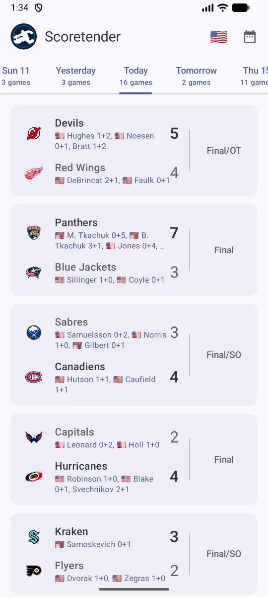
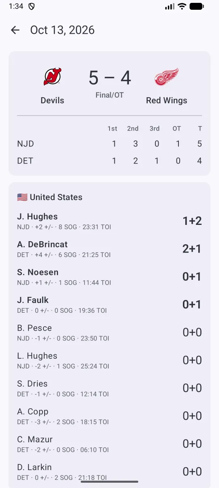

# Scoretender

Hockey scores for Android, with the players from your country up front. In Finland the app is called **Änärivahti**.

<p>
  
  
</p>

- Scores day by day: swipe between days or jump to any date from the calendar
- Live games update on their own
- Pick a country and its players are listed under every score
- Game details: score by period, goal scorers, team stats, goalies and three stars
- No account, ads or tracking ([privacy policy](https://nevalla.github.io/scoretender/privacy.html))

## Building

Requires JDK 17 or newer (the one bundled with Android Studio works) and the Android SDK.

```sh
./gradlew assembleDebug        # build the app
./gradlew installDebug         # install it on a connected device or emulator
./gradlew testDebugUnitTest    # run the unit tests
```

Release builds are signed when a `keystore.properties` file in the project root points to the upload key; without it they're left unsigned. The file is gitignored:

```properties
storeFile=/path/to/upload-key.jks
storePassword=...
keyAlias=upload
keyPassword=...
```

```sh
./gradlew bundleRelease        # signed app bundle for Google Play
```

The app is written in Kotlin with Jetpack Compose and Material 3, and supports Android 8.0 (API 26) and newer.

## Data

Scores and stats come from the NHL's public web API (`api-web.nhle.com` and `api.nhle.com`). The API is undocumented and may change without notice.

## Website

`docs/` holds the landing page and privacy policy, published with GitHub Pages at [nevalla.github.io/scoretender](https://nevalla.github.io/scoretender/).

## License

[MIT](LICENSE)

Scoretender is an independent app and isn't affiliated with or endorsed by the National Hockey League. NHL and team names, logos and data belong to the NHL and its teams.
